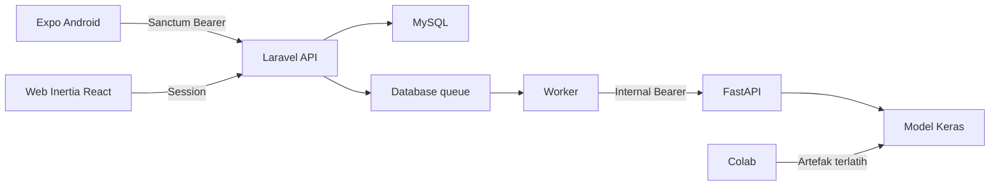

# Arsitektur

Laravel adalah sumber otorisasi dan data. User hanya mengelola laporannya saat Pending. Admin mengelola seluruh laporan dan pengguna. Transisi status dibatasi dan dicatat. Foto tersimpan privat, dengan akses melalui controller berotorisasi. Prediksi gagal tidak membatalkan laporan. Versi foto mencegah hasil pekerjaan lama menimpa foto terbaru.

Struktur Laravel: Form Request → Controller → Action → Model; Policy menangani kepemilikan; Job menghubungi PredictionClient. Expo menyimpan token di SecureStore. FastAPI tidak mengakses database.
