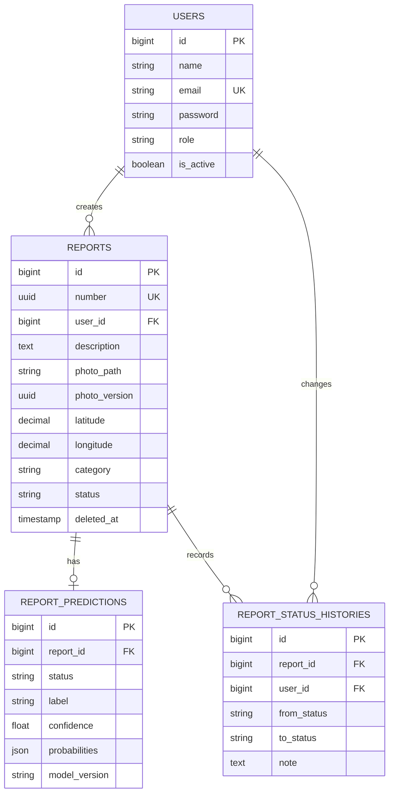

# ERD

Semua tabel domain memiliki created_at dan updated_at. Migration Laravel merupakan schema yang dapat dijalankan. Tabel sessions, jobs, cache, dan personal_access_tokens mendukung autentikasi dan queue.
