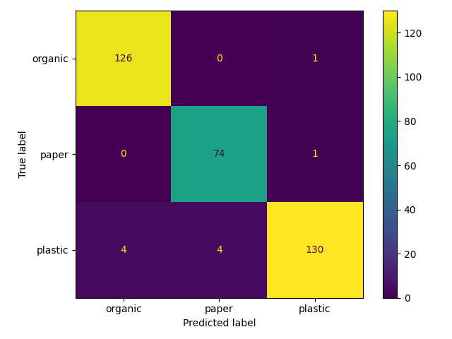

# Evaluasi model aktual

Training dijalankan 3 November 2026 di Google Colab, GPU T4, Python 3.13.16 dan TensorFlow 2.21.0.

- Dataset bersih: 2262 gambar RealWaste setelah pembersihan duplikasi.
- Training: 1583, validation: 339, testing: 340.
- Testing accuracy: **97.06%** (330/340 benar).
- Macro F1: 0.9703.
- Model version: `9fdcea1e664b`.
- SHA256: `9fdcea1e664b842bdfb098d3e256f1b02eaf333dd772f03a1598f59864dde927`.

| Kelas | Precision | Recall | F1 | Support |
|---|---:|---:|---:|---:|
| organic | 0.9692 | 0.9921 | 0.9805 | 127 |
| paper | 0.9487 | 0.9867 | 0.9673 | 75 |
| plastic | 0.9848 | 0.9420 | 0.9630 | 138 |

Baris menunjukkan label aktual, kolom prediksi; urutan organic, paper, plastic.

Sumber: RealWaste (Single, Iranmanesh, Raad, 2023), UCI, CC BY 4.0, DOI 10.24432/C5SS4G. Food Organics dan Vegetation menjadi organic, Paper menjadi paper, Plastic menjadi plastic. Enam gambar duplikat/sangat mirip dihapus sebelum split; test tidak dipakai memilih hyperparameter. Hasil ini mengukur dataset testing RealWaste, bukan jaminan akurasi semua foto lapangan.

Notebook eksekusi: https://colab.research.google.com/drive/1qWqn7zdkOima9YWaKe_pdjvbks-366QJ
Manifest aktual tersedia di `ml/manifests/split.csv`; JSON metrik dan metadata model berada di folder docs. Arsip model menyertakan dependency runtime Colab aktual.
